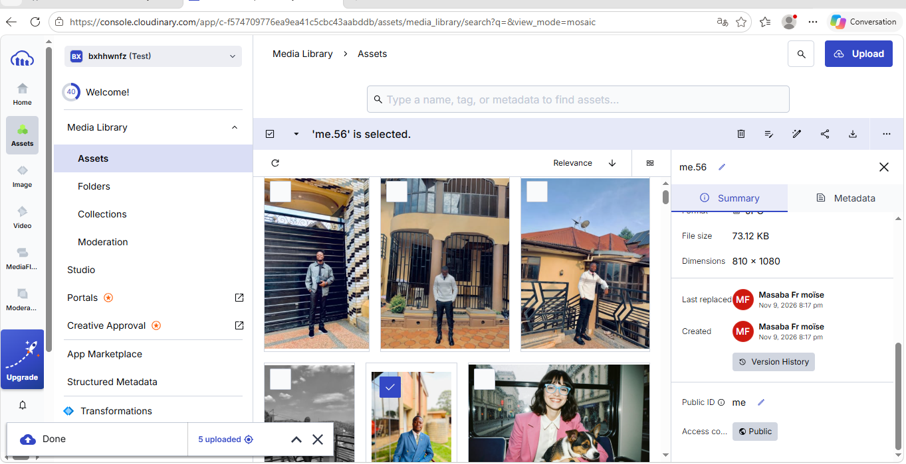

# Fragments — Galerie Cloudinary

Une galerie photographique responsive, en français et sans dépendance de build. Les images sont servies par **Cloudinary** ; le site apporte une page d’accueil éditoriale, une galerie consultable et une fiche de détail interactive pour chaque image.

Les cinq URL publiques des images du compte Cloudinary `bxhhwnfz` sont déjà configurées dans [`app.js`](./app.js). Cloudinary distribue directement chaque image à partir de son identifiant public : `me2`, `ME3`, `me1`, `ME4` et `me`.

## Contenu livré

- **Accueil et présentation** : identité visuelle, titre, navigation, appel à explorer, présentation du projet et pied de page avec lien vers GitHub.
- **Galerie** : cinq emplacements nommés `me2`, `ME3`, `me1`, `ME4` et `me`, avec un titre et une courte description pour chaque image.
- **Fiche interactive** : cliquez sur une carte pour ouvrir ses détails, son adresse publique, et les commandes **Copier l’URL** et **Télécharger**. Les commandes restent désactivées tant qu’une URL valide manque.
- **Recherche** par titre, description ou identifiant ; navigation au clavier avec la touche `/`.
- **Mise en page responsive**, commandes accessibles au clavier, textes alternatifs et prise en compte des préférences de réduction des animations.
- **Capture Cloudinary** fournie dans la consigne : [docs/images/cloudinary-media-library.png](./docs/images/cloudinary-media-library.png).
- **Publication GitHub Pages** à chaque push sur `main`, via [`.github/workflows/pages.yml`](./.github/workflows/pages.yml).

## Ajouter les images Cloudinary

1. Dans la Media Library Cloudinary, ouvrez chaque image et copiez son **URL publique de livraison** (« Copy delivery URL »).
2. Si vous modifiez les images, mettez à jour l’URL complète correspondante dans la propriété `url` de [`app.js`](./app.js).
3. Vérifiez qu’une adresse commence par `https://res.cloudinary.com/` et qu’elle affiche effectivement l’image dans un navigateur. Les URL doivent désigner des images dont vous êtes autorisé à publier le contenu.
4. Enregistrez puis actualisez le site. Les cinq images sont affichées dans la galerie. En cliquant sur une photo, vous pourrez copier son adresse ou lancer son téléchargement.

Les URL de livraison sont publiques : **ne mettez jamais de clé API, de secret Cloudinary ou d’identifiants privés dans `app.js`, dans ce dépôt ou dans le site**.

## Lancer le site en local

Le projet n’a ni étape de compilation ni dépendance npm. Vous pouvez ouvrir `index.html` dans un navigateur, ou utiliser un serveur local :

```bash
python -m http.server 8000
```

Visitez ensuite `http://localhost:8000`. Configurez des URL réelles dans `app.js` avant de vérifier l’affichage des photos, leur copie et leur téléchargement. Le téléchargement direct nécessite que la ressource soit publique et accessible par le navigateur ; en cas de refus réseau ou CORS, l’interface affiche une erreur explicite.

## Publier avec GitHub Pages

Le dépôt est destiné à [`frmoisemasaba/TP_cloudinary`](https://github.com/frmoisemasaba/TP_cloudinary). Le workflow fourni construit le site statique et déploie le contenu du dépôt à chaque push sur `main`.

1. Ajoutez vos URL Cloudinary dans `app.js`.
2. Envoyez les fichiers sur la branche `main`.
3. Le workflow active automatiquement GitHub Pages et sélectionne GitHub Actions comme source de publication.
4. Vérifiez l’exécution dans **Actions** puis ouvrez le site public une fois le workflow terminé.

L’adresse Pages attendue pour ce dépôt est [https://frmoisemasaba.github.io/TP_cloudinary/](https://frmoisemasaba.github.io/TP_cloudinary/).

## Arborescence

```text
.
├── .github/workflows/pages.yml    # Publication GitHub Pages
├── app.js                         # Photos, recherche et actions de la fiche
├── docs/images/                   # Capture d’écran Cloudinary
├── index.html                     # Structure et contenu de la page
├── README.md                      # Consignes d’installation et de livraison
└── styles.css                     # Identité visuelle et adaptations mobiles
```

## Capture de la Media Library Cloudinary


